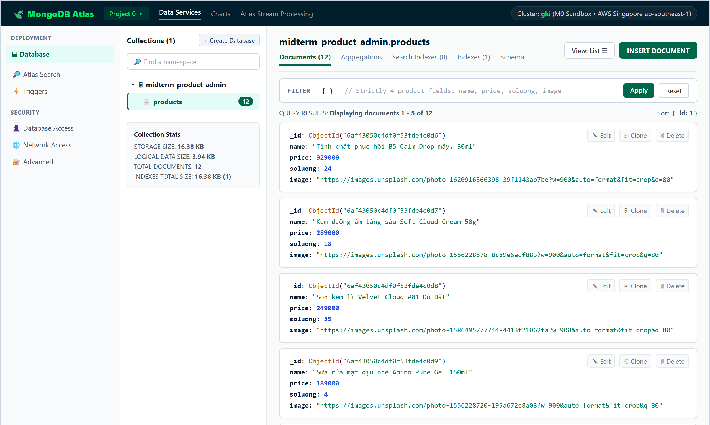
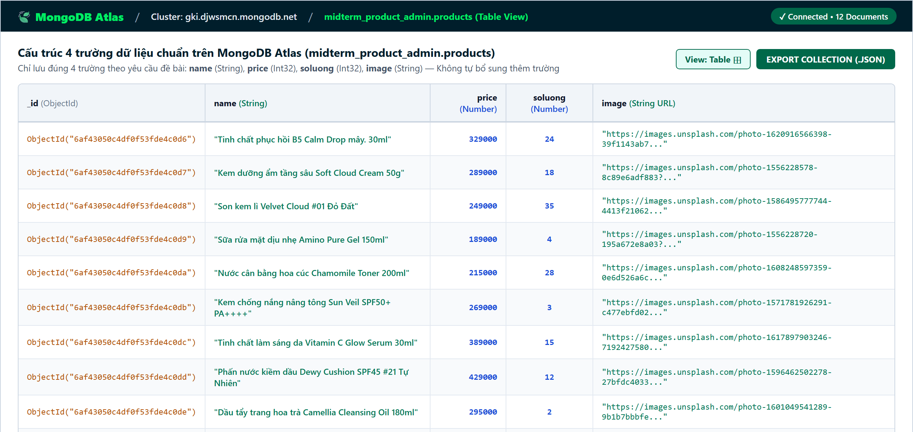
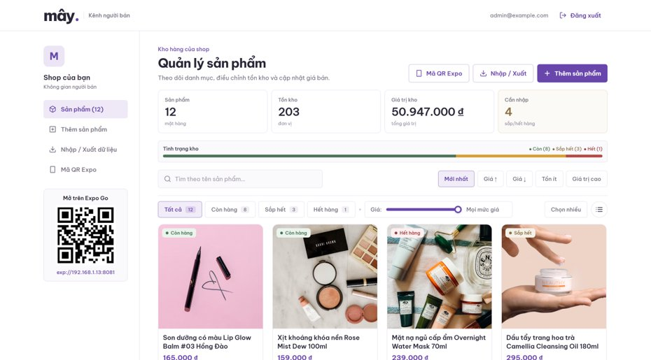
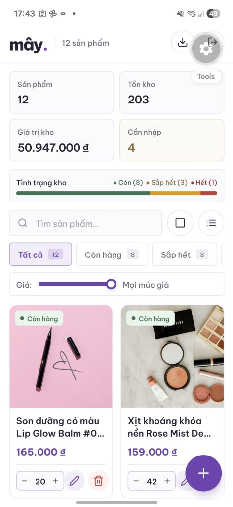
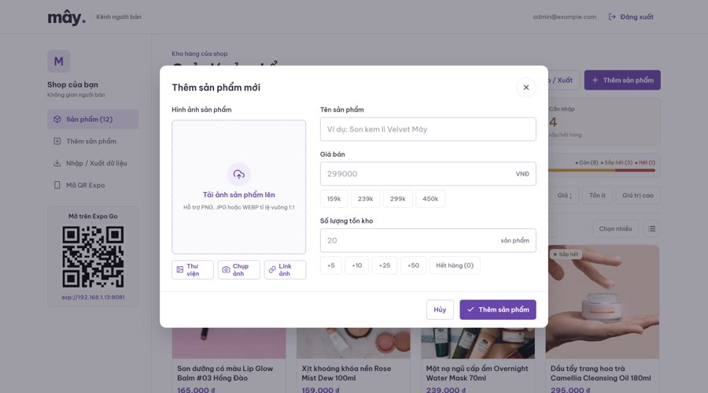
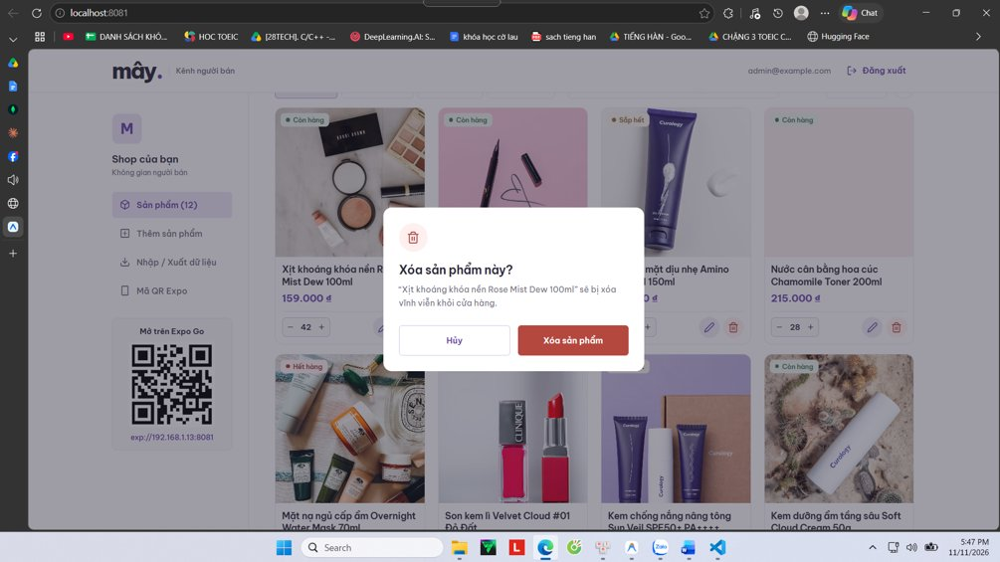

# ☁️ mây. — Ứng dụng Quản lý Sản phẩm Đa Nền Tảng (Web & Mobile)

> **Báo cáo Giữa kỳ Lập trình Đa Nền Tảng**  
> Hệ thống quản trị kho và danh mục mỹ phẩm **Kênh người bán mây.** được xây dựng bằng **React Native (Expo SDK 58)** kết hợp **Node.js / Express REST API**, cơ sở dữ liệu đám mây **MongoDB Atlas** và lưu trữ hình ảnh **Cloudflare R2**.

---

## ✨ Tính năng nổi bật & Đáp ứng yêu cầu đề bài

### 1. Cơ sở dữ liệu chuẩn 4 trường tuyệt đối (`name`, `price`, `soluong`, `image`)
- Lưu trữ trực tiếp trên **MongoDB Atlas** (`midterm_product_admin.products`) và tự động đồng bộ 2 chiều với file [`apps/api/data/products.json`](./apps/api/data/products.json).
- Mongoose Schema được khóa chặt với `strict: 'throw'`, `versionKey: false`, `timestamps: false` để đảm bảo mỗi bản ghi **chỉ chứa đúng 4 trường**:
  - `name` *(String)*: Tên sản phẩm
  - `price` *(Number)*: Giá bán (VNĐ, số nguyên không âm)
  - `soluong` *(Number)*: Số lượng tồn kho (số nguyên không âm)
  - `image` *(String)*: Đường dẫn URL hình ảnh sản phẩm (Cloudflare R2 CDN hoặc URL ảnh)





---

### 2. Giao diện & Chức năng Quản trị thực tế trên ứng dụng (Web & Mobile)
- 🔐 **Xác thực Quản trị viên (JWT Authentication)**: Bảo vệ toàn bộ các thao tác Thêm / Sửa / Xóa bằng Bearer Token (`POST /api/auth/login`), hỗ trợ nút điền nhanh tài khoản mẫu (`admin@example.com`) để kiểm thử.
- 📊 **Bảng điều khiển Tổng quan kho hàng (Dashboard)**:
  - Hiển thị trực quan 4 chỉ số thời gian thực: **Sản phẩm** (`12 mặt hàng`), **Tồn kho** (`203 đơn vị`), **Giá trị kho** (`50.947.000 ₫`) và **Cần nhập** (`4 sắp/hết hàng`).
  - **Thanh Tình trạng kho**: Phân bổ tỷ lệ trực quan giữa mặt hàng **Còn (`8`)**, **Sắp hết (`3`)** và **Hết (`1`)**.
  - Giao diện tương thích đa thiết bị (**Responsive**): Bố cục thanh bên (Sidebar) kèm lưới 4 cột trên trình duyệt **Web**, và tự động thu gọn thành lưới 2 cột kèm nút nổi `+` trên **Điện thoại (Expo Go)**.

#### 🖥️ Giao diện Tổng quan Quản lý sản phẩm trên Web (`http://localhost:8081`)


#### 📱 Giao diện Quản lý sản phẩm thực tế trên Điện thoại (Expo Go)
<p align="center">
  
</p>

- 📦 **Quản lý sản phẩm toàn diện (CRUD) & Tải ảnh lên Cloudflare R2**:
  - **Thêm mới & Cập nhật sản phẩm**: Form nhập liệu hỗ trợ chọn nhanh mức giá gợi ý (`159k`, `239k`, `299k`, `450k`) và cộng nhanh số lượng tồn kho (`+5`, `+10`, `+25`, `+50`, `Hết hàng (0)`).
  - **Nhập hình ảnh đa phương thức**: Hỗ trợ **Thư viện** (chọn ảnh từ máy), **Chụp ảnh** (mở trực tiếp Camera trên điện thoại qua `expo-image-picker`), hoặc **Link ảnh** (dán URL). Ảnh tải lên từ thiết bị được tự động ký xác thực AWS Signature V4 (`apps/api/src/r2.ts`) đẩy lên bucket **Cloudflare R2** và trả về đường dẫn CDN công khai.
  - **Xóa sản phẩm an toàn**: Hộp thoại xác nhận **"Xóa sản phẩm này?"** trước khi xóa vĩnh viễn khỏi cửa hàng và MongoDB Atlas.

#### ➕ Hộp thoại Thêm sản phẩm mới (Hỗ trợ Thư viện / Chụp ảnh / Link ảnh)


#### 🗑️ Hộp thoại Xác nhận xóa sản phẩm


- 🎚️ **Tìm kiếm, Thanh trượt lọc giá (`PriceSlider`) & Sắp xếp đa tiêu chí**:
  - Tìm kiếm tức thì theo tên sản phẩm tiếng Việt (`Tìm theo tên sản phẩm...`).
  - Lọc nhanh theo tình trạng tồn kho: **Tất cả (`12`)**, **Còn hàng (`8`)**, **Sắp hết (`3`)**, **Hết hàng (`1`)**.
  - **Thanh trượt lọc giá (`Giá: Mọi mức giá` / `≤ ... ₫`)**: Kéo mượt mà trên cả chuột máy tính lẫn màn hình cảm ứng điện thoại để lọc sản phẩm theo mức giá trần, kèm nút `×` đặt lại nhanh.
  - Sắp xếp theo 5 tiêu chí: **Mới nhất**, **Giá ↑**, **Giá ↓**, **Tồn ít**, **Giá trị cao**.
- ⚡ **Điều chỉnh tồn kho 1 chạm & Thao tác hàng loạt (`Chọn nhiều`)**:
  - Nút `-` / `+` điều chỉnh trực tiếp số lượng tồn kho ngay trên từng thẻ sản phẩm và `-5` / `-1` / `+1` / `+5` / `+10` trong hộp thoại chi tiết.
  - Chế độ **Chọn nhiều** cho phép cộng thêm `+10` tồn kho, giảm giá `-10%`, hoặc xóa hàng loạt.
- 🔄 **Nhập / Xuất dữ liệu JSON & Mã QR Expo Go trực tiếp**:
  - Nút **Nhập / Xuất** hỗ trợ tải xuống hoặc nhập hàng loạt danh sách sản phẩm chuẩn 4 trường (`products.json`).
  - Tích hợp khung **Mở trên Expo Go (`exp://192.168.1.13:8081`)** ngay trên thanh bên trái giao diện Web để quét mã QR mở nhanh ứng dụng trên điện thoại.

---

## 🏗️ Kiến trúc & Cấu trúc thư mục

```text
midterm-react-native-admin/
├── apps/
│   ├── api/                             # Phân hệ Backend (Node.js + Express + TypeScript)
│   │   ├── data/
│   │   │   └── products.json            # File CSDL JSON chuẩn 4 trường (đồng bộ 2 chiều với MongoDB)
│   │   ├── src/
│   │   │   ├── product.model.ts         # Mongoose Schema khóa chặt 4 trường (name, price, soluong, image)
│   │   │   ├── validation.ts            # Kiểm tra dữ liệu đầu vào chuẩn 4 trường
│   │   │   ├── validation.test.ts       # Unit tests kiểm thử bộ dữ liệu 4 trường
│   │   │   ├── r2.ts                    # Dịch vụ tải ảnh lên đám mây Cloudflare R2 (AWS SigV4)
│   │   │   └── server.ts                # Express REST API, JWT Auth & Đồng bộ MongoDB Atlas
│   │   └── .env.example                 # Mẫu cấu hình biến môi trường Backend
│   │
│   └── mobile/                          # Phân hệ Frontend Đa nền tảng (Expo SDK 58 — Web & Mobile)
│       ├── src/
│       │   ├── api.ts                   # HTTP Client tự động nhận diện LAN IP cho Web & Expo Go
│       │   ├── session.ts               # Lưu trữ phiên đăng nhập quản trị viên
│       │   ├── theme.ts                 # Hệ thống màu sắc & Typography thương hiệu "mây."
│       │   ├── types.ts                 # Kiểu dữ liệu TypeScript
│       │   ├── ui.tsx                   # Design System & Thanh trượt lọc giá (PriceSlider)
│       │   ├── components/
│       │   │   ├── ProductCard.tsx      # Thẻ hiển thị sản phẩm (Grid / List & tăng giảm tồn nhanh)
│       │   │   ├── ProductFormModal.tsx # Hộp thoại Thêm / Sửa & Chọn/Chụp ảnh (expo-image-picker)
│       │   │   ├── ProductDetailModal.tsx # Hộp thoại Chi tiết sản phẩm & Điều chỉnh kho
│       │   │   ├── AdvancedModals.tsx   # Hộp thoại Xuất/Nhập JSON, Mã QR Expo & Xác nhận xóa
│       │   │   └── Feedback.tsx         # Toast thông báo & Skeleton loading
│       │   └── screens/
│       │       ├── LoginScreen.tsx      # Màn hình Đăng nhập quản trị viên
│       │       └── ProductsScreen.tsx   # Màn hình Tổng quan Quản lý sản phẩm
│       ├── App.tsx                      # Điểm vào ứng dụng React Native
│       └── .env.example                 # Mẫu cấu hình biến môi trường Frontend
├── screenshots_app/                     # Ảnh chụp giao diện thực tế trên Web & Điện thoại (Expo Go)
├── screenshots_mongo/                   # Ảnh chụp cơ sở dữ liệu MongoDB Atlas thực tế
├── Bao_Cao_Giua_Ky_React_Native_Admin.docx # File báo cáo Word chi tiết
├── package.json                         # Scripts quản lý toàn bộ workspace
└── pnpm-workspace.yaml                  # Cấu hình pnpm monorepo
```

---

## 🚀 Hướng dẫn cài đặt và khởi chạy

### 1. Yêu cầu môi trường
- **Node.js** `>= 20.x`
- **pnpm** `>= 9.x` (`npm install -g pnpm`)
- Ứng dụng **Expo Go** trên điện thoại Android / iOS *(nếu kiểm thử trên thiết bị di động thật cùng mạng Wi-Fi)*

### 2. Cài đặt thư viện
Tại thư mục gốc của dự án, chạy lệnh:

```bash
pnpm install
```

### 3. Cấu hình biến môi trường (`.env`)
Sao chép file mẫu `.env.example` sang `.env` ở phân hệ `apps/api`:

```bash
cp apps/api/.env.example apps/api/.env
```

Cập nhật các thông số trong `apps/api/.env` (thay bằng thông tin kết nối của bạn):

```env
PORT=3001
HOST=0.0.0.0
MONGODB_URI=mongodb+srv://<username>:<password>@<cluster-url>/midterm_product_admin?retryWrites=true&w=majority
ADMIN_EMAIL=admin@example.com
ADMIN_PASSWORD=your_admin_password
JWT_SECRET=your_jwt_secret_key
R2_ACCOUNT_ID=your_cloudflare_account_id
R2_BUCKET_NAME=your_r2_bucket_name
R2_ACCESS_KEY_ID=your_r2_access_key_id
R2_SECRET_ACCESS_KEY=your_r2_secret_access_key
R2_PUBLIC_BASE_URL=https://pub-xxxxxxxxxxxx.r2.dev
```

> **Lưu ý:** Nếu chưa cấu hình `MONGODB_URI`, máy chủ vẫn tự động hoạt động mượt mà với cơ chế lưu trữ dự phòng vào file [`apps/api/data/products.json`](./apps/api/data/products.json).

### 4. Khởi chạy ứng dụng

- **Mở Terminal 1 — Chạy máy chủ Backend API (cổng `3001`):**
  ```bash
  pnpm dev:api
  ```

- **Mở Terminal 2 — Chạy ứng dụng Frontend Đa nền tảng (Web & Mobile Expo Go tại cổng `8081`):**
  ```bash
  pnpm --filter @midterm/mobile start --lan --port 8081
  ```
  - **Trên trình duyệt Web:** Truy cập `http://localhost:8081`
  - **Trên điện thoại:** Mở ứng dụng **Expo Go** và quét mã QR trên Terminal hoặc ngay trong khung **Mở trên Expo Go** ở thanh bên trái giao diện Web.

---

## 🔌 Danh sách REST API Endpoints

| Phương thức | Endpoint | Xác thực | Mô tả chức năng |
| :--- | :--- | :---: | :--- |
| `GET` | `/api/health` | Không | Kiểm tra trạng thái kết nối MongoDB Atlas, Cloudflare R2 và danh sách IP LAN |
| `POST` | `/api/auth/login` | Không | Đăng nhập quản trị viên, trả về `JWT Bearer Token` |
| `GET` | `/api/products` | Có | Lấy danh sách toàn bộ sản phẩm từ MongoDB Atlas (`midterm_product_admin.products`) |
| `POST` | `/api/products` | Có | Thêm sản phẩm mới (tự động upload ảnh base64 lên Cloudflare R2 nếu có) |
| `POST` | `/api/products/bulk` | Có | Nhập hàng loạt sản phẩm chuẩn 4 trường từ JSON |
| `PATCH` | `/api/products/:id` | Có | Cập nhật thông tin sản phẩm (`name`, `price`, `soluong`, `image`) |
| `DELETE` | `/api/products/:id` | Có | Xóa vĩnh viễn sản phẩm khỏi MongoDB Atlas và đồng bộ `products.json` |

---

## 🧪 Kiểm thử tự động (Unit Tests & Build)

```bash
# Chạy kiểm thử bộ kiểm tra dữ liệu 4 trường (validation.test.ts)
pnpm test

# Kiểm tra biên dịch TypeScript toàn dự án
pnpm build
```
